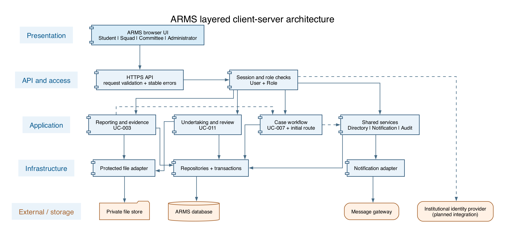

# Assignment 6: Architectural design

## 1. Chosen architecture

ARMS uses a layered client-server design. A browser renders role-specific pages and calls a server API. The API checks the session and role, then passes work to the report, case, undertaking, directory and notification components. Repositories store records in a relational database. A private file store keeps evidence and signed PDFs. A notification gateway delivers messages after the main record is saved.

## 2. Layers and responsibilities

| Layer | Responsibility | Main dependencies |
| --- | --- | --- |
| Browser UI | Show forms, case history, verification review, field errors and confirmation. It never decides permission by itself. | HTTPS API |
| API and access | Authenticate a request, enforce role permissions, validate request shape and return a stable error code. | Application components, institutional identity provider when available |
| Application components | Carry out UC-003 report submission, UC-007 status updates and UC-011 undertaking submission/review. They use the domain classes and rules in the design class model. | Repositories, file store adapter, notification component |
| Persistence and delivery | Store records, maintain transaction boundaries, protect files and dispatch messages. | Database, private file storage, notification gateway |

The institutional identity provider and message gateway are integration points, not claims that the current prototype has those services. Until they are configured, the prototype uses a demonstration sign-in and in-memory messages.

## 3. Communication for the three use cases

UC-003: Student UI -> report API -> access check -> report component -> case workflow applies the category-based initial route using active directory entries -> case, evidence, first history entry and audit record -> database/file store -> notification component -> relevant authorized users. The response returns the case ID and current status.

UC-007: Handler UI -> case API -> access check -> `CaseStatusValidator` -> case and history update in one transaction -> audit record -> notification component -> named reporter and authorized handlers. A closed case requires a separate committee reopening action with a reason.

UC-011: Student or guardian UI -> undertaking API -> file validation -> undertaking record and protected PDF -> administrator review UI -> verification record -> notification component. Rejection keeps the reason and permits corrected resubmission. An accepted undertaking for the same session blocks a duplicate.

## 4. Why this structure fits ARMS

The three use cases share identity, audit, notifications and private storage. Keeping those concerns behind server interfaces avoids repeating access rules in several pages. It also makes it possible to replace the demonstration data without changing the screens. The case and undertaking components have different lifecycles, so their decisions remain separate. A simple request-response API is enough for the expected student-team scale.

## 5. Trust and failure boundaries

The browser must not trust a role chosen in a client control. The server derives the actor and role from the authenticated session. It checks that a reporter sees only their own named case and that a handler has permission for the selected case. Every protected file request repeats this check. The API returns `403` for denied access, `404` when a record is unavailable to that user, `409` for a stale version or disallowed state, and `422` for missing or invalid input.

The case or undertaking transaction is the point at which the operation is confirmed. Message delivery runs after commit and may be retried. If the database save fails, the UI must not show a success case ID. If a file upload fails, the undertaking remains unsubmitted. These rules support the SRS reliability and privacy requirements.
