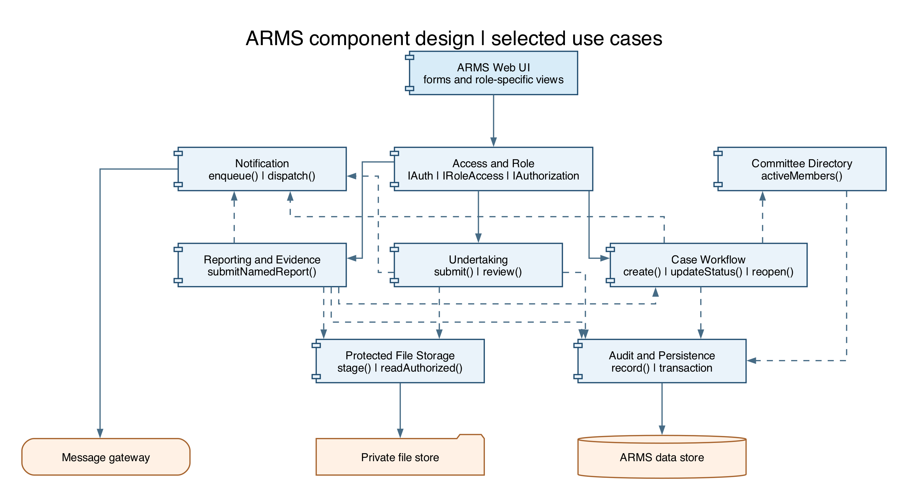

# Assignment 7: Component-level design

## 1. Component map



| Component | Main responsibility | Design classes and operations | Interfaces used |
| --- | --- | --- | --- |
| Access and role | Resolve the session and permission for each protected request. | `User`, `Role.hasPermission()` | `IAuth`, `IRoleAccess`, `IAuthorization` |
| Reporting and evidence | Validate a named report and optional evidence; request case creation. | `Case`, `EvidenceAttachment.validateFileType()` | `IReportSubmission`, `IFileStorage`, `ICaseCreation`, `IAuditLog` |
| Case workflow | Create the case with its initial category-based route; show a permitted case view; validate and save status changes. | `Case.updateStatus()`, `Case.close()`, `CaseHistory.recordChange()`, `CaseStatusValidator.canTransition()` | `ICaseCreation`, `ICaseWorkflow`, `IRoutingDirectory`, `IAuthorization`, `IAuditLog`, `INotification` |
| Undertaking | Submit a signed PDF and record administrator review. | `Undertaking.submit()`, `Undertaking.resubmit()`, `UndertakingVerification.accept()/reject()` | `IUndertaking`, `IFileStorage`, `IAuthorization`, `IAuditLog`, `INotification` |
| Notification | Prepare and dispatch messages after a saved change. | `Notification.send()`, `NotificationService.dispatch()` | `INotification`, `IMessageDelivery` |
| Directory | Return active authorized body contacts used in the initial route and authorized directory view. | `CommitteeDirectoryEntry` | `IDirectoryQuery`, `IRoutingDirectory` |
| Audit and persistence | Keep required event records and transactions. | `AuditLog.recordAction()` and repositories for persisted classes | `IAuditLog`, `IDataAccess` |

The diagram refines the submitted Assignment 5 component model by naming the operations needed for the three selected use cases. The initial category rule remains inside Case Workflow and uses the Committee Directory. There is no separate routing module.

## 2. UC-003: submit a named report

**Operation:** `submitNamedReport(actor, request, evidenceToken?, idempotencyKey)` in Reporting and Evidence.

**Preconditions:** the actor is an authenticated student; the idempotency key has not produced another case; category and description are present. Incident date/time and location are recorded when known. Evidence is optional.

```text
1. Check the student's session and permission to submit a named report.
2. Validate category, description and optional incident details.
3. If evidenceToken exists, inspect file type and size. If invalid, return an
   attachment error that permits the student to retry without the file.
4. Begin a database transaction.
5. Create a unique case ID and a Case with reporterId = actor.userId,
   reportMode = named and currentStatus = Reported.
6. Use the category rule and active Committee Directory entries to select
   the initial authorized body; store it as Case.assignedBody.
7. If evidence is valid, attach its private file reference to this Case.
8. Record the initial transition from Reported to Acknowledged in CaseHistory,
   set Case.currentStatus = Acknowledged, and add the AuditLog record.
9. Commit the transaction. If commit fails, return failure and no case ID.
10. Queue a confirmation for the reporter and a new-case notification for
    the selected authorized body. Record delivery failure for retry.
11. Return the case ID and Acknowledged status.
```

**Exceptions:** Missing mandatory input returns `422`; wrong role returns `403`; rejected evidence returns `415` or `413` without deleting the entered report fields; data-store failure returns `503`. If no active contact exists for the selected body, the case goes to administrator review rather than being silently dropped. If a retry carries the same idempotency key, return the already created case rather than creating a second one. File cleanup is required if an upload was staged but the case transaction fails.

## 3. UC-007: update case status

**Operation:** `updateCaseStatus(actor, caseId, nextStatus, actionNote, expectedVersion)` in Case Workflow.

**Preconditions:** the actor is an authorized Squad or Committee member for the selected case; a case exists; the action note is non-empty. Ordinary status updates require an open case.

```text
1. Resolve the actor and load the case with its current version.
2. Check permission to view and update this case.
3. Reject an empty action note, a stale expectedVersion or a closed case.
4. Ask CaseStatusValidator.canTransition(case, actor, nextStatus).
5. If false, return INVALID_TRANSITION without changing the case.
6. Begin a database transaction.
7. Change Case.currentStatus and increment Case.version.
8. Append CaseHistory(previousStatus, nextStatus, note, actor, now).
9. Append AuditLog(actor, status changed, caseId, now).
10. Commit the transaction. If any mandatory write fails, roll it back.
11. Queue a status message for the named reporter and relevant handlers.
12. Return the new status, version and history entry ID.
```

Only a Committee member may close a case after recording the final action or reason. Reopening is a separate operation: it requires Committee permission, a non-empty reason, the `Closed` status, and a new history and audit entry. A reporter receives only an appropriate status message, not private findings. A stale version returns `409` so one handler cannot silently overwrite another's work.

The transition table implements the sequence in the submitted Assignment 5 case state diagram. The UI shows only permitted choices for the current actor, and the server checks again when saving.

| Current status | Next status | Actor / condition |
| --- | --- | --- |
| Reported | Acknowledged | System, after ID creation and initial assignment |
| Acknowledged | Under Investigation | Authorized Squad member |
| Under Investigation | Findings Recorded | Authorized Squad member; finding note required |
| Findings Recorded | Escalated to Committee | Authorized handler; escalation note required |
| Escalated to Committee | Committee Decision Recorded | Committee member; decision note required |
| Committee Decision Recorded | Action Taken | Committee member; action note required |
| Action Taken | Closed | Committee member; final action or closure reason required |
| Closed | Under Investigation | Committee member; separate reopening operation and reason required |

Additional evidence can be recorded while a case remains Under Investigation. That activity does not create a new status by itself.

## 4. UC-011: submit and verify an undertaking

**Operation:** `submitUndertaking(actor, studentId, semester, pdfToken, declarationAccepted)` in Undertaking.

**Preconditions:** the student identity is known; the actor is the student or an allowed parent/guardian; the signed PDF is staged; the declaration checkbox is accepted.

```text
1. Check permission to submit for studentId and the selected session.
2. Require a PDF and inspect its actual file type and size.
3. Load the current undertaking for studentId and semester.
4. If it is Accepted/Verified, return ALREADY_VERIFIED.
5. If it is Rejected, retain its old review and create a new submitted version.
6. Save the private PDF reference, set submittedById = actor.userId and
   status = Pending Verification.
7. Write the AuditLog entry in the same transaction.
8. Commit, then queue an administrator notification.
9. Return the undertaking ID and Pending Verification status.
```

**Administrator decision:** `reviewUndertaking(admin, undertakingId, decision, reason?, expectedVersion)` checks administrator permission and the current `Pending Verification` status. Reject requires a reason. A transaction appends `UndertakingVerification`, sets the undertaking to `Accepted/Verified` or `Rejected`, increments its version, and writes an audit record. The notification is queued after commit. A stale version or a second decision returns `409`; missing reason returns `422`. A rejected student may submit a corrected PDF, while an accepted current-session undertaking cannot be duplicated.

The submitted state diagram also shows `Form Opened`, `Information Entered`, `Submitted` and `Validating Information`. These are UI and processing steps. The stored status starts at `Pending Verification` after a valid save. It then becomes `Accepted/Verified` or `Rejected`. A corrected rejected submission returns to `Pending Verification`; an accepted record stays read-only for that session.

## 5. Shared implementation conditions

Every operation gets its actor from the server session. The server validates file content as well as the filename extension. Private files are retrieved only through an authorization check. Case history, verification decisions and audit records are append-only in normal use. Messages may be retried, but a retry must not duplicate a case, a history change or a review. The current website demonstrates screens and local state; these server transactions are the proposed implementation design.
