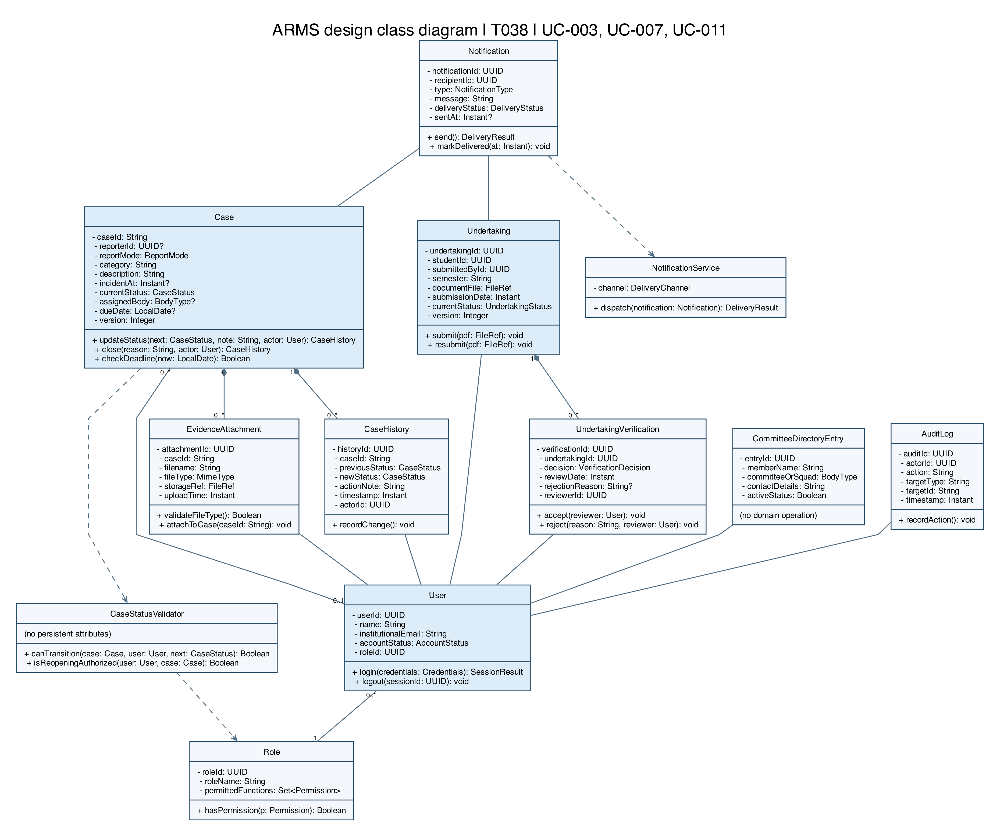

# Assignment 6: Data and class design

## 1. Scope and notation

This is an implementation-oriented refinement of the twelve-class ARMS model carried in Assignment 5. It keeps the earlier association, composition, and dependency choices. There is no inheritance or aggregation. Attribute visibility is private (`-`); operations shown in the diagram are public (`+`). `UUID` is an opaque record ID, `Instant` is a timestamp with timezone, `LocalDate` is a calendar date, and `FileRef` is a private storage key rather than a public URL. Enumerations such as `CaseStatus` and `UndertakingStatus` are value types, not additional domain classes.

In the diagram, a solid line is an association, a filled diamond marks composition at the owner, and a dashed arrow is a behavioural dependency. The relationship names and multiplicities are detailed in Section 3 so the drawing remains readable.

## 2. Refined classes

| Class | Stored attributes and types | Important operations and responsibility |
| --- | --- | --- |
| `User` | `userId: UUID`, `name: String`, `institutionalEmail: String`, `accountStatus: AccountStatus`, `roleId: UUID` | `login(credentials): SessionResult`, `logout(sessionId): void`; identify the actor for protected actions. Authentication is implemented by the access service, not by storing passwords in this object. |
| `Role` | `roleId: UUID`, `roleName: String`, `permittedFunctions: Set<Permission>` | `hasPermission(permission: Permission): Boolean`; provide the permission decision used by the validator. |
| `Case` | `caseId: String`, `reportMode: ReportMode`, `reporterId: UUID?`, `description: String`, `category: String`, `incidentAt: Instant?`, `location: String?`, `currentStatus: CaseStatus`, `assignedBody: BodyType?`, `dueDate: LocalDate?`, `closureReason: String?`, `version: Integer` | `updateStatus(next: CaseStatus, note: String, actor: User): CaseHistory`, `close(reason: String, actor: User): CaseHistory`, `checkDeadline(now: LocalDate): Boolean`; own evidence and history. `assignedBody` records the initial category-based route without adding a new class. `version` prevents silent concurrent overwrites. |
| `EvidenceAttachment` | `attachmentId: UUID`, `caseId: String`, `filename: String`, `fileType: MimeType`, `sizeBytes: Long`, `storageRef: FileRef`, `uploadTime: Instant`, `uploaderId: UUID` | `validateFileType(): Boolean`, `attachToCase(caseId: String): void`; point to a permitted file stored privately. |
| `CaseHistory` | `historyId: UUID`, `caseId: String`, `previousStatus: CaseStatus`, `newStatus: CaseStatus`, `actionNote: String`, `timestamp: Instant`, `actorId: UUID` | `recordChange(): void`; preserve the actor, note and time for each transition. |
| `Undertaking` | `undertakingId: UUID`, `studentId: UUID`, `submittedById: UUID`, `semester: String`, `parentOrGuardianName: String?`, `documentFile: FileRef`, `submissionDate: Instant`, `currentStatus: UndertakingStatus`, `version: Integer` | `submit(pdf: FileRef): void`, `resubmit(pdf: FileRef): void`; store the student, the submitting student or guardian, and the current-session status. |
| `UndertakingVerification` | `verificationId: UUID`, `undertakingId: UUID`, `decision: VerificationDecision`, `reviewDate: Instant`, `rejectionReason: String?`, `reviewerId: UUID` | `accept(reviewer: User): void`, `reject(reason: String, reviewer: User): void`; record each administrator decision. |
| `Notification` | `notificationId: UUID`, `recipientId: UUID`, `type: NotificationType`, `message: String`, `deliveryStatus: DeliveryStatus`, `sentAt: Instant?`, `caseId: String?`, `undertakingId: UUID?` | `send(): DeliveryResult`, `markDelivered(at: Instant): void`; represent a message without exposing protected details to the wrong recipient. |
| `CommitteeDirectoryEntry` | `entryId: UUID`, `memberName: String`, `committeeOrSquad: BodyType`, `designation: String`, `contactDetails: String`, `activeStatus: Boolean`, `userId: UUID?` | No domain operation in the locked model; the directory service queries active entries. |
| `AuditLog` | `auditId: UUID`, `actorId: UUID`, `action: String`, `targetType: String`, `targetId: String`, `timestamp: Instant` | `recordAction(): void`; keep a separate account of protected changes. |
| `CaseStatusValidator` | No persisted attributes | `canTransition(case: Case, user: User, next: CaseStatus): Boolean`, `isReopeningAuthorized(user: User, case: Case): Boolean`; check lifecycle and role rules before mutation. |
| `NotificationService` | `channel: DeliveryChannel` | `dispatch(notification: Notification): DeliveryResult`; send a prepared notification to the configured channel. |

`CaseStatusValidator` and `NotificationService` are service classes. They have no database table. Persistence adapters and API controllers in the architecture are implementation components, not new domain classes.

## 3. Relationships and multiplicity

| Link | UML type | Multiplicity / rule |
| --- | --- | --- |
| `User` to `Role` | Association | Each user has one role; a role may belong to many users. |
| `Case` to reporter `User` | Association | Each named case has one reporter; an anonymous case has none. A user may report many cases. |
| `Case` to `EvidenceAttachment` | Composition | One case owns zero or more attachments; an attachment belongs to one case. |
| `Case` to `CaseHistory` | Composition | One case owns zero or more history entries; an entry belongs to one case. |
| `EvidenceAttachment` to uploader `User` | Association | One uploader per attachment; a user may upload many. |
| `CaseHistory` to actor `User` | Association | One actor per history entry; a user may make many updates. |
| `Undertaking` to submitting `User` | Association | One submitting student or guardian per undertaking; a user may submit many across sessions. `studentId` identifies the student the document concerns. |
| `Undertaking` to `UndertakingVerification` | Composition | An undertaking owns zero or more review records. |
| `UndertakingVerification` to reviewer `User` | Association | One administrator per review; an administrator may review many. |
| `Notification` to `Case` or `Undertaking` | Association | Each notification may reference one relevant record; a record may have many notifications. |
| `CommitteeDirectoryEntry` to `User` | Association | Optional one-to-one link to an account. |
| `AuditLog` to actor `User` | Association | One actor per log entry; an actor may have many entries. |
| `Case` to `CaseStatusValidator`; validator to `Role`; `Notification` to `NotificationService` | Dependency | Behavioural use only; no ownership or stored object relationship. |

## 4. Persistent data and constraints

The data store needs records for `users`, `roles`, `cases`, `evidence_attachments`, `case_history`, `undertakings`, `undertaking_verifications`, `notifications`, `committee_directory_entries`, and `audit_logs`. A case ID is unique. User email is unique among active accounts. Foreign keys connect child records to their owner and actor. The application must enforce one accepted undertaking per student and academic session. A rejected undertaking can be resubmitted as a new version while retaining review history.

Evidence and signed undertaking PDFs live in protected file storage. The database stores file metadata and a private `storageRef`. The UI receives an authorized download endpoint rather than the storage key. Case submission, its first history entry and its audit record should commit together. A status update, its history entry and audit record should also commit together. Notification delivery can occur after that transaction; a delivery failure must not erase a saved case update.

Indexes should cover `cases(caseId)`, `cases(reporterId, currentStatus)`, `case_history(caseId, timestamp)`, `undertakings(studentId, semester)`, and `notifications(recipientId, sentAt)`. Access checks apply to record reads as well as writes.
